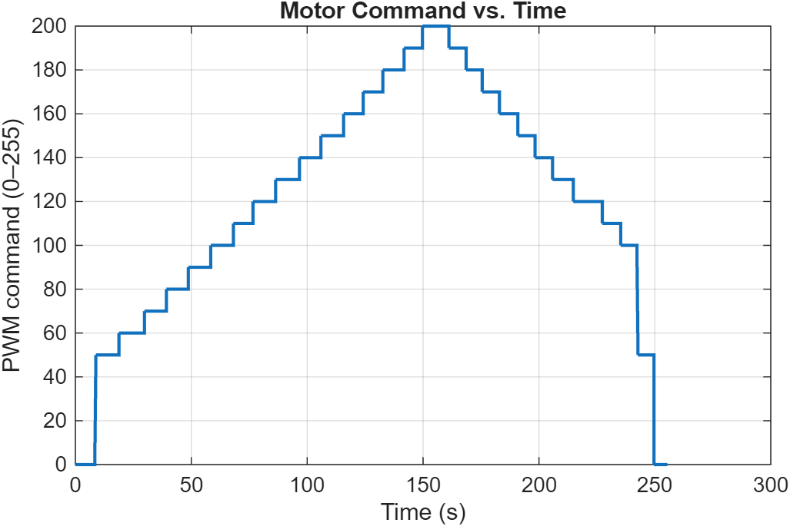
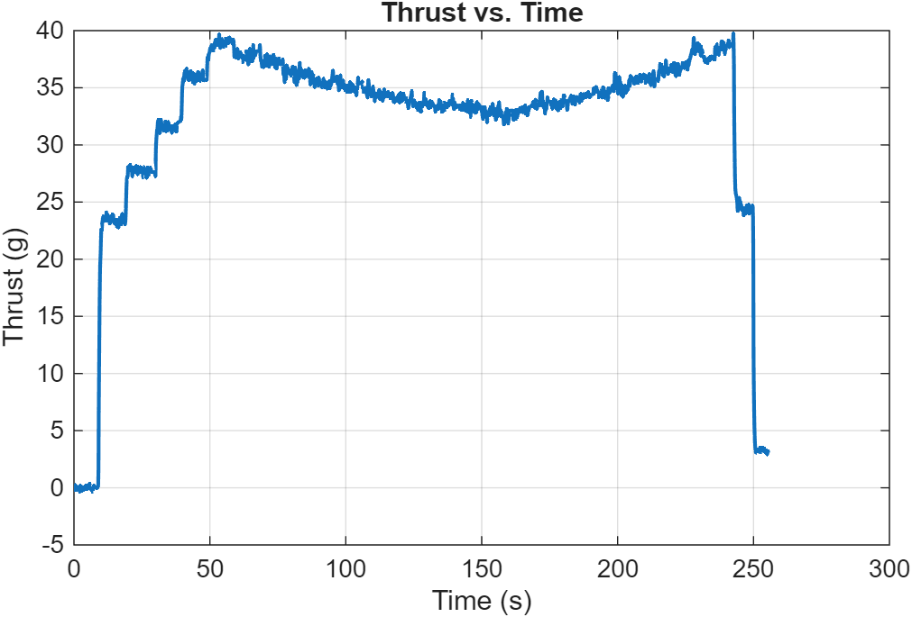

# Electric Propeller Thrust Stand

A self-directed project: an Arduino-based thrust stand that measures static thrust of a DC-motor-driven propeller across a sweep of motor commands.

## What's here
| Path | Contents |
|---|---|
| `firmware/thrust_stand/thrust_stand.ino` | Arduino sketch: sets motor PWM from serial input and streams raw HX711 load-cell counts, supply voltage, and a ready flag at 10 Hz |
| `cad/` | Full stand assembly (STEP, STL) and a printable thruster bracket (STL, 3MF, render) |
| `docs/` | Parts list |

## Hardware
| Function | Component | Pin |
|---|---|---|
| Thrust sensing | Load cell + HX711 24-bit amplifier | DOUT → D2, SCK → D3 |
| Motor drive | PWM output | D5 |
| Supply voltage | Analog sense | A0 |

## Results
## Results
First full test completed (Nov 2026): a stepped PWM sweep from 50 to 200 in increments of 10, held about 10 s per step, then stepped back down. Each point is the mean of 50–95 samples. Standard deviation stayed under 0.75 g.

  
  

- **Peak thrust: 38.8 g at PWM 90**
- Thrust then fell steadily to **32.8 g at PWM 200**
- The down-sweep tracked the up-sweep within about 1 g, so the drop-off is repeatable and not just random noise
- The load cell read about 3.3 g after the run, up from about 0 g before it (zero drift, visible at the far right of the thrust plot)

Thrust *falling* at higher command is unexpected. Next step is to work out why, using the logged supply voltage (sag under load?), an RPM sensor, and a re-zero between steps.

## Dependencies
- [HX711 Arduino library](https://github.com/RobTillaart/HX711) (install through the Arduino Library Manager)
